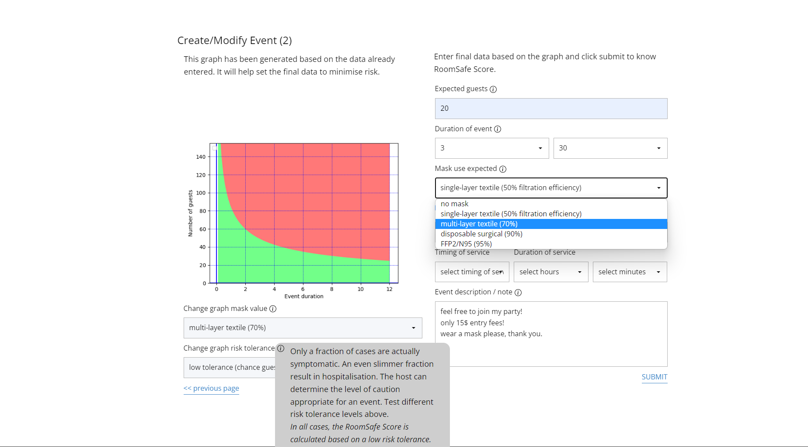
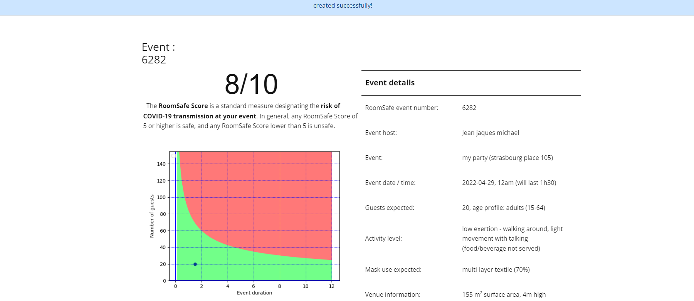

# RoomSafe

A web app that estimates the risk of COVID-19 airborne transmission at an indoor event before it happens, and shows the host how to make it safer.

Built in 2021–2022 by Marin de Vanssay and Julian Máthé at the European School of Brussels I. It won 3rd place at the International Science Festival of European Schools.





## What it does

A host describes the event: floor area and ceiling height, ventilation, air filtration, humidity, number of guests, duration, expected mask use, activity level and the guests' age profile. RoomSafe returns a **RoomSafe Score** out of 10 (5 or more counts as safe) and a graph of guests against duration, with the safe zone in green and the unsafe zone in red. The host can change the inputs and see the score move before setting the final plan.

Each event gets a number. Guests can sign up to it with their own details (mask, age, activity), and the score is recalculated with the real guest list.

## The model

Indoors, the room air is treated as well mixed (long-range airborne transmission). An infectious guest breathes out droplets carrying virus; the concentration in the room builds up following a mass balance, and droplets are removed by:

- ventilation (air changes per hour),
- filtration of recirculated air,
- settling to the floor (Stokes drag sets the fall speed of each droplet size),
- the virus losing its activity over time, faster at higher humidity.

The dose each guest breathes in, reduced by masks on both sides, gives the expected number of transmissions, which becomes the score. Outdoor events use a separate short-range model. The calculation is in `calculator.py` (with the guest list) and `Hcalculator.py` (host estimate), and the graph in `Mgraph` in `app.py`.

## Running it

Python 3.9 or later:

```sh
pip install -r requirements.txt
python init_db.py          # creates an empty Mcode.db from schema.sql
flask --app app run
```

Then open http://127.0.0.1:5000, create an account and host an event.

## About the code

This is the code as it stood in May 2022, written while learning web development (Flask, SQLite, HTML/CSS), with one fix since then so sign-up works on current Python. Some pages are still work in progress. The site layout uses the Nicepage CSS framework and jQuery, included in `static/`.
